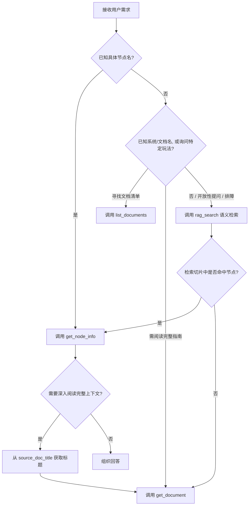

# 千星沙箱知识库 Skill API 调用规范与使用指南（Agent 专用）

> **目标受众**：AI Agent / LLM 工具调用执行器  
> **服务协议**：HTTP RESTful（JSON 请求体与响应体）  
> **基础路径规范**：`http://<HOST>:<PORT>/api/v1/skills`

---

## 1. 协议概述与接口约定

本服务将千星沙箱（Miliastra UGC 编辑器）知识库的各项检索与查询能力封装为标准 HTTP API。Agent 可以通过发现接口获取能力列表，也可以直接调用具体的原子工具接口。

### 1.1 基础请求格式
- **HTTP Method**：
  - 能力发现：`GET`
  - 工具调用：`POST`
- **Request Headers**：
  - `Content-Type: application/json`
  - `Accept: application/json`
- **批量原则（重要）**：
  - **所有工具入参均原生支持列表（数组）**。如果需要查询多个节点或主题，**必须合并为单次批量调用**，严禁拆分成多轮顺序单条请求。

### 1.2 通用响应外壳结构
所有接口均遵循统一的包装结构：

```json
{
  "success": true,
  "data": {
    "skill": "miliastra-knowledge",
    "tool": "<调用工具名>",
    "result": {} // 实际业务数据，可能是 Array 或 Object
  },
  "error": null
}
```

- **检查流程**：
  1. 先校验 HTTP 状态码是否为 `200`。
  2. 检查顶层 `success` 是否为 `true`。若为 `false`，从 `error` 读取错误原因。
  3. 业务数据从 `data.result` 获取。

---

## 2. 接口能力清单与地址映射

基础服务地址示例：`http://10.100.200.19:8000` 或 `http://localhost:8000`。

| 工具标识 (`tool_name`) | 请求方法 | 相对路径 (`http_path`) | 适用场景 |
| :--- | :---: | :--- | :--- |
| **能力发现** | `GET` | `/api/v1/skills` | 获取技能元数据及可用工具清单 |
| **`get_node_info`** | `POST` | `/api/v1/skills/miliastra-knowledge/tools/get_node_info` | 按节点名查参数、归属端与来源文档 |
| **`list_documents`** | `POST` | `/api/v1/skills/miliastra-knowledge/tools/list_documents` | 浏览官方文档标题与路径（无正文） |
| **`get_document`** | `POST` | `/api/v1/skills/miliastra-knowledge/tools/get_document` | 按标题获取官方指南/教程全文及关联节点 |
| **`list_client_documents`** | `POST` | `/api/v1/skills/miliastra-knowledge/tools/list_client_documents` | 列出客户端控件/Lua 脚本文档标题 |
| **`get_client_document`** | `POST` | `/api/v1/skills/miliastra-knowledge/tools/get_client_document` | 获取客户端控件/脚本文档全文 |
| **`rag_search`** | `POST` | `/api/v1/skills/miliastra-knowledge/tools/rag_search` | 语义向量检索相关文档片段与相似度 |
| **`translate_terms`** | `POST` | `/api/v1/skills/miliastra-knowledge/tools/translate_terms` | 多语言官方术语翻译校准 |

---

## 3. Agent 决策与工具路由流程

在处理用户需求时，请按照以下优先级进行工具路由：



### 3.1 核心路由准则
1. **结构化工具优先，`rag_search` 兜底**：
   - 知道确切节点名时，直接用 `get_node_info`。
   - 不清楚文档名时，先用 `list_documents` 查看候选，再用 `get_document` 取正文。
   - 仅在遇到**复杂排障**（如“为什么怪不攻击”）、**开放式设计**或模糊概念时使用 `rag_search`。
2. **端归属区分（服务端 vs 客户端）**：
   - `get_node_info` 返回的 `side` 字段标明了执行端：
     - `server`：服务端节点图（实体节点图）。
     - `client`：客户端节点图（角色技能、造物状态决策、过滤器等）。
     - `both`：双端通用。
   - 若用户询问客户端 UI / 控件 / 客户端脚本相关内容，改用 `list_client_documents` / `get_client_document`。

---

## 4. 工具详细规格说明

### 4.1 能力发现：`GET /api/v1/skills`
- **入参**：无。
- **返回示例**：
  ```json
  {
    "success": true,
    "data": [
      {
        "id": "miliastra-knowledge",
        "version": "1.2.0",
        "title": "Miliastra Knowledge",
        "tools": [
          {
            "name": "get_node_info",
            "description": "根据节点名称查询节点说明、参数表、所属文档。",
            "http_path": "/api/v1/skills/miliastra-knowledge/tools/get_node_info",
            "parameters": [
              { "name": "names", "type": "string[]", "required": true, "description": "节点名称列表" }
            ]
          }
        ]
      }
    ],
    "error": null
  }
  ```

---

### 4.2 节点查询：`POST .../tools/get_node_info`
根据节点名称模糊匹配节点参数、功能说明、归属端及所属文档。

- **请求体（JSON）**：
  ```json
  {
    "names": ["创建实体", "嘲讽目标"]
  }
  ```
- **关键响应字段解析**：
  - `matches[].title`：节点名称。
  - `matches[].side`：节点运行端（`server` / `client` / `both`）。
  - `matches[].source_doc_title`：所在官方文档标题（可用于下一步 `get_document`）。
  - `matches[].content`：节点 Markdown 正文（包含参数表格与配图）。
- **示例返回**：
  ```json
  {
    "success": true,
    "data": {
      "skill": "miliastra-knowledge",
      "tool": "get_node_info",
      "result": [
        {
          "query": "创建实体",
          "matches": [
            {
              "title": "创建实体",
              "main_title": "实体相关",
              "side": "server",
              "source_doc_title": "执行节点",
              "content": "**节点说明**：通过 GUID 创建实体...\n| 参数 | 类型 | 说明 |\n| 目标GUID | GUID | 实体模板标识 |"
            }
          ]
        }
      ]
    }
  }
  ```

---

### 4.3 文档列表检索：`POST .../tools/list_documents`
列出知识库文档列表，供确认文档准确标题。支持空数组（列出全量文档）或按关键词模糊过滤。

- **请求体（JSON）**：
  ```json
  {
    "keywords": ["仇恨", "造物"]
  }
  ```
  *(传入 `{"keywords": []}` 可获取全部文档列表)*
- **示例返回**：
  ```json
  {
    "success": true,
    "data": {
      "result": [
        {
          "keyword": "仇恨",
          "total": 1,
          "documents": [
            { "title": "仇恨配置", "file": "official/guide/mhxx_仇恨配置.md" }
          ]
        }
      ]
    }
  }
  ```

---

### 4.4 文档正文获取：`POST .../tools/get_document`
获取官方文档完整内容，同时自动聚合该文档关联的常用节点信息。

- **请求体（JSON）**：
  ```json
  {
    "titles": ["仇恨配置", "碰撞触发器"]
  }
  ```
- **状态字段 `status` 判断**：
  - `ok`：命中 1~5 篇，在 `documents` 中返回正文。
  - `too_many`：命中大于 5 篇（说明关键词过泛），仅返回简要标题清单，**Agent 必须使用更精确的标题重查**。
  - `not_found`：未命中，返回 `available_titles_sample` 供参考。
- **示例返回**：
  ```json
  {
    "success": true,
    "data": {
      "result": [
        {
          "query": "仇恨配置",
          "status": "ok",
          "documents": [
            {
              "title": "仇恨配置",
              "file": "official/guide/mh_仇恨配置.md",
              "content": "# 仇恨配置\n\n## 仇恨系统概述...",
              "related_nodes": []
            }
          ]
        }
      ]
    }
  }
  ```

---

### 4.5 语义向量检索：`POST .../tools/rag_search`
当用户问题描述宽泛、属于故障排查或不清楚具体节点名时，使用自然语言进行语义检索。

- **请求体（JSON）**：
  ```json
  {
    "queries": ["怪物如何追击玩家", "掉落物不刷新怎么排查"],
    "top_k": 5
  }
  ```
  - `queries`：自然语言查询列表（`string[]`，必填）。
  - `top_k`：单项查询最多返回的切片数量（整数，取值范围 `1 ~ 20`，默认 5）。
- **示例返回**：
  ```json
  {
    "success": true,
    "data": {
      "result": [
        {
          "query": "怪物如何追击玩家",
          "total_results": 2,
          "results": [
            {
              "title": "仇恨配置",
              "h1_title": "仇恨系统",
              "file_name": "mh_仇恨配置.md",
              "similarity": 0.7825,
              "text_snippet": "当实体具备战斗属性并配置了仇恨组件时，通过设置仇恨目标节点..."
            }
          ]
        }
      ]
    }
  }
  ```
- **使用建议**：
  - `similarity` 仅作为排序参考。
  - `text_snippet` 截断为最多 200 字；如需完整的配置步骤或参数限制，建议提取 `title` 调用 `get_document` 获取全文。

---

### 4.6 客户端专项文档：`list_client_documents` 与 `get_client_document`
专门用于查询客户端控件（2D UI、HUD 提示、触控按钮等）与客户端 Lua 脚本文档。

- **查询列表**：`POST .../tools/list_client_documents`
  ```json
  { "keywords": ["控件", "按钮"] }
  ```
- **获取正文**：`POST .../tools/get_client_document`
  ```json
  { "titles": ["提示控件", "预设按钮控件"] }
  ```

---

## 5. Agent 回答生成准则与最佳实践

1. **真实性与证据引用**：
   - 必须以接口返回的实际内容为准，**严禁自行编造节点名称或参数属性**。
   - 回答中请标明节点运行端（如：*“【创建实体】（服务端节点）”*）。
2. **渐进式检索套路**：
   - **典型玩法方案生成**：`rag_search(自然语言)` $\rightarrow$ 提取关键节点 $\rightarrow$ `get_node_info(节点列表)` $\rightarrow$ 提取背景文档 $\rightarrow$ `get_document(文档标题)`。
3. **查空与容错处理**：
   - 若 `get_node_info` 返回空，请缩短搜索词（如由 `"角色定点发射投射物"` 简化为 `"发射"` 或 `"投射物"`）。
   - 若依然查无结果，调用 `rag_search` 查找可能关联的设计说明。
   - 若确认知识库未收录，如实告知用户，并建议其调整提问角度或检查命名。
